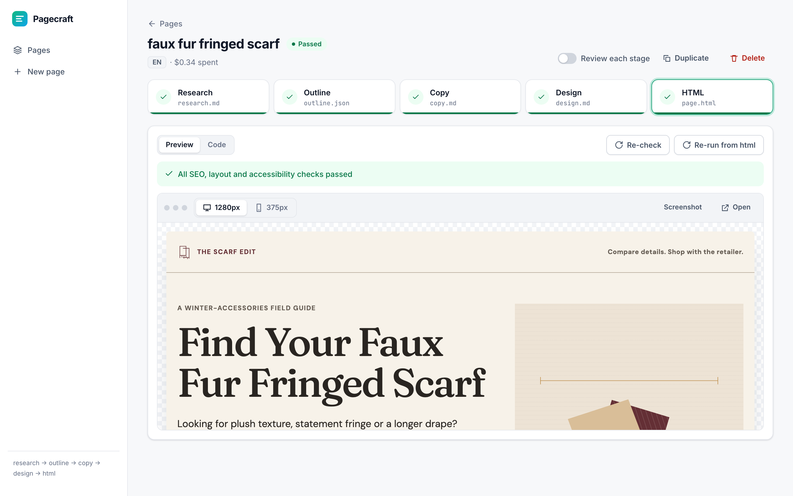
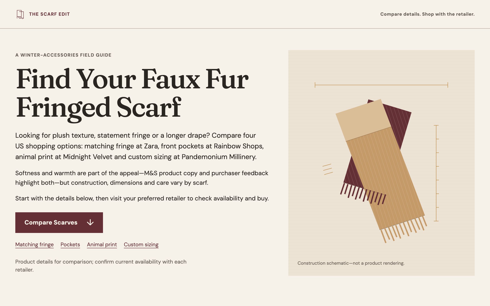
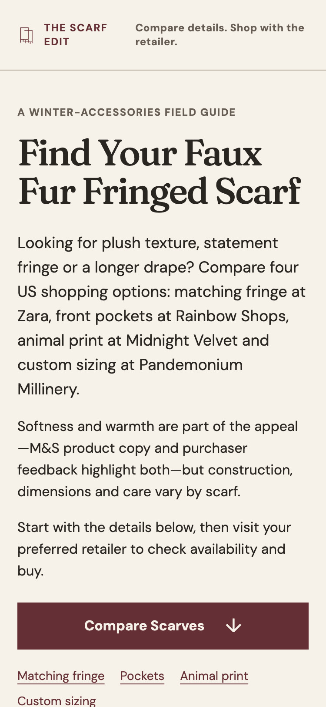
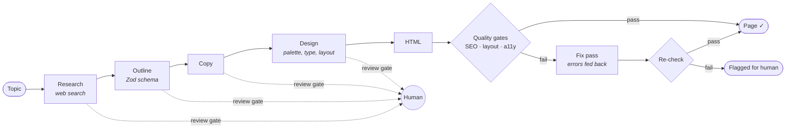
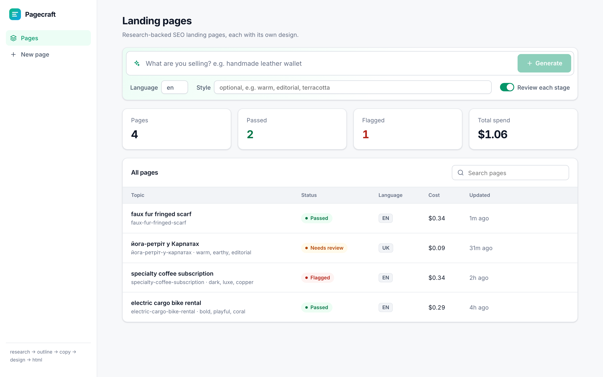
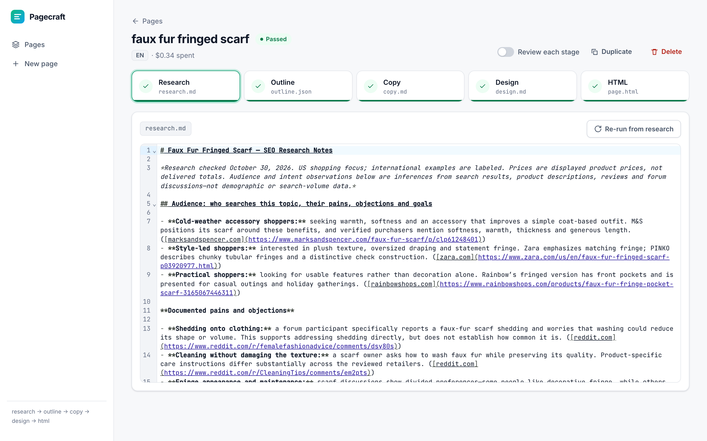

# Landing Generation Orchestrator

**An LLM orchestration pipeline that turns a topic into a researched, designed, and validated SEO landing page, with a live dashboard where you can watch, review, and correct every stage.**

`topic → web research → outline → copy → design → HTML → automated quality gates`



This is not a single "write me a landing page" prompt. It's a multi-stage **orchestrator**: each stage is a separate LLM call with its own role, inputs and output contract. Results are saved as files you can edit, quality gates validate the output in a real browser, a self-correction loop feeds failures back to the model, and a human can approve or edit between stages.

---

## Real example

One real, unedited run with the topic **"faux fur fringed scarf"**:

| | |
|---|---|
| Stages | 5 (research, outline, copy, design, html), all run automatically |
| Wall time | ~4.5 minutes |
| Cost | **$0.34** (tracked per run from token usage + web search calls) |
| Research | 83 lines of notes with sources from 9 sites (Zara, M&S, Farfetch, Bloomingdale's, Reddit, …) |
| Outline | 7 sections, schema-validated (Zod structured output) |
| Output | 455-line self-contained HTML with JSON-LD (`WebPage` + `FAQPage`) |
| Quality gates | passed SEO, layout (375px + 1280px) and axe-core accessibility checks |

| Desktop (1280px) | Mobile (375px) |
|---|---|
|  |  |

The design ("plush, tailored, tactile", warm ivory and oxblood, an SVG construction schematic instead of photos) was invented by the design stage for this topic. Every page gets its own look.

---

## How the orchestration works



| Orchestration concern | How it's handled |
|---|---|
| **Stage contract** | Each stage is a `StageDef` (`name`, `file`, optional `model`, `run(ctx)`, optional `validate`). The pipeline only knows this interface. A new stage is one file plus one line in the `STAGES` array. |
| **Typed dependencies** | Stages read each other's output by imported object (`ctx.read(outline)`), never by string names, so renaming a stage is a type error rather than a runtime bug. |
| **Artifacts as state** | Every stage writes a file to `out/<id>/`, and `run.json` holds status, checks and cost. Runs can be resumed, inspected and edited, with no database. |
| **Resumability** | "Re-run from here" re-executes from any stage using the files on disk, including your edits. Upstream work, such as the paid web research, is never redone. |
| **Human in the loop** | With per-page review gates on, the run stops after each stage. You edit the file in the browser and click Continue. A stopped run simply ends; nothing holds a request open. |
| **Structured output** | The outline uses OpenAI Structured Outputs with a Zod schema. Hand edits to `outline.json` are validated against the same schema before saving. |
| **Grounding** | The research stage uses the Responses API `web_search` tool and must cite a URL for every number. Later stages may not invent statistics, testimonials, prices or awards. |
| **Self-correction** | After the HTML stage, the quality gates run. On failure, the exact error list and the previous HTML go back to the model for one fix pass, then the page is checked again. If it still fails, it's saved and **flagged**, not silently shipped. |
| **Model routing** | Each stage has a default model (`gpt-6.1-sol`) and can override it, e.g. switch only the HTML stage to `gpt-6-astra`. |
| **Cost accounting** | Token usage and web search calls are priced per call and summed per page. The dashboard shows the cost per page and in total. |
| **Streaming and observability** | The pipeline emits typed events (`record`, `stage-start`, `delta`, `search`, `log`), and the server streams them over SSE. A client that connects mid-run gets the events so far replayed. |
| **Concurrency** | One job at a time (a run, a re-check or a fix), enforced in `server/jobs.ts`. Others get HTTP 409. Adding parallel jobs or a queue would only change that file. |
| **Failure recovery** | A failed stage is marked `failed` with its error. A server restart mid-run marks that run as interrupted, so it can be re-run instead of hanging forever. |

### Quality gates

| Gate | Tool | Checks |
|---|---|---|
| SEO | `linkedom` | exactly one `<h1>`, `<title>` ≤ 60 characters, meta description ≤ 160 characters, `<html lang>` matches the requested language, viewport meta, no external scripts |
| Layout | Playwright (Chromium) | no horizontal overflow at 375px and 1280px, no console or JS errors, full-page screenshots saved |
| Accessibility | axe-core | every WCAG violation axe reports, e.g. contrast of the colours the design stage invented |

---

## Dashboard



- **Live run view:** a stage stepper, token-by-token output, web search queries as they happen, and check results.
- **Review and edit:** CodeMirror editor for every stage file (markdown, JSON, HTML), with schema validation on save.
- **Preview:** a sandboxed iframe (scripts disabled) at mobile and desktop width, plus the browser-check screenshots.
- **Actions:** Continue, Re-run from any stage, Re-check (free, no LLM call), Fix with AI, Duplicate with a new style (keeps research, outline and copy, re-runs only design and HTML), Delete.



> The scarf page in these screenshots is a real generation. The other rows in the dashboard list (yoga retreat, coffee subscription, cargo bike) are sample entries added to show the different statuses.

---

## Architecture

```
src/                 the pipeline: plain TypeScript, no HTTP, no UI
  types.ts           StageDef, Ctx, RunRecord, PipelineEvent
  pipeline.ts        runStages (review gates), recheck, fix
  llm.ts             streaming OpenAI calls bound to a model; cost + search hooks
  pages.ts           storage: out/<id>/ folders, run.json, id validation
  stages/            research, outline, copy, design, html (+ shared prompt rules)
  checks/            seo.ts, browser.ts (Playwright + axe), index.ts
  cli.ts             thin CLI entry point
server/              Hono REST + SSE API; jobs.ts = single active job + event bus
web/src/             React + Vite dashboard
docs/adr/            architecture decision records
```

There are three layers with one-way dependencies: `web → server → src`. The pipeline runs the same way from the CLI, the API or a test, because it knows nothing about HTTP.

### Tech stack

| Area | Choice |
|---|---|
| Language | TypeScript on Node 22+ (native type stripping, no build step for the backend) |
| LLM | OpenAI Responses API: streaming, `web_search` tool, Structured Outputs |
| Validation | Zod 4 |
| API | Hono + Server-Sent Events |
| UI | React 19, Vite, CodeMirror 6, native `<dialog>`, light and dark themes |
| Quality gates | Playwright, axe-core, linkedom |

### Key decisions

Each decision has an ADR with context and trade-offs:

1. [LLM writes the full HTML](docs/adr/0001-llm-writes-full-html.md): for dozens of pages with a distinct look each, quality gates beat templates.
2. [TypeScript + OpenAI, model per stage](docs/adr/0002-typescript-and-openai.md): start on the cheaper model, upgrade one stage if needed.
3. [Five stages with editable files on disk](docs/adr/0003-staged-pipeline-on-disk.md): grounding and human review as the defence against thin AI content.
4. [A design stage per page](docs/adr/0004-design-stage-per-page.md): an explicit, editable visual direction instead of one generic look.
5. [Browser checks with Playwright + axe](docs/adr/0005-browser-layout-check.md): catch the bugs LLM-written HTML is most likely to have.
6. [Web dashboard](docs/adr/0006-web-dashboard.md): SSE streaming, review gates, single-job concurrency, security boundaries.

Domain terms are defined in [GLOSSARY.md](GLOSSARY.md).

---

## Getting started

```bash
npm install
npx playwright install chromium
cp .env.example .env        # add your OPENAI_API_KEY
npm run dev                 # dashboard: http://localhost:5173
```

CLI (same pipeline, no review gates; the page also shows up in the dashboard):

```bash
npm run gen -- "handmade leather wallet" --lang en --style "warm, editorial, terracotta"
```

Production-like: `npm run build && npm start` serves the built dashboard from the API (127.0.0.1:8790).

### Extending: add a stage

```ts
// src/stages/keywords.ts
export const keywords: StageDef = {
  name: 'keywords',
  file: 'keywords.md',
  run: async ({ read, text }) => text({ instructions: '…', input: await read(research) }),
};
// src/stages/index.ts
export const STAGES = [research, keywords, outline, copy, design, html];
```

Streaming, cost tracking, review gates, the editor and the API pick it up with no other changes.

### Tests

```bash
npm test            # slug/id safety + SEO and browser gates (no API key needed)
npm run typecheck   # server and web
```

---

## Security

- The API binds to `127.0.0.1` only, and the OpenAI key never leaves the server.
- Page ids and stage names are validated before any file system access, so path traversal is rejected (covered by tests).
- Generated pages are previewed in a sandboxed iframe with scripts disabled.

## Limitations and roadmap

- One job at a time and a single user, with no auth. It's built as a local tool.
- Topics are entered one by one; batch input and a job queue would be the next step.
- No images yet (CSS/SVG only). A stock-photo stage and a vision-model design critique are natural extensions.
- No evaluation harness yet for comparing prompt or model changes across a fixed topic set.

## License

[MIT](LICENSE)
